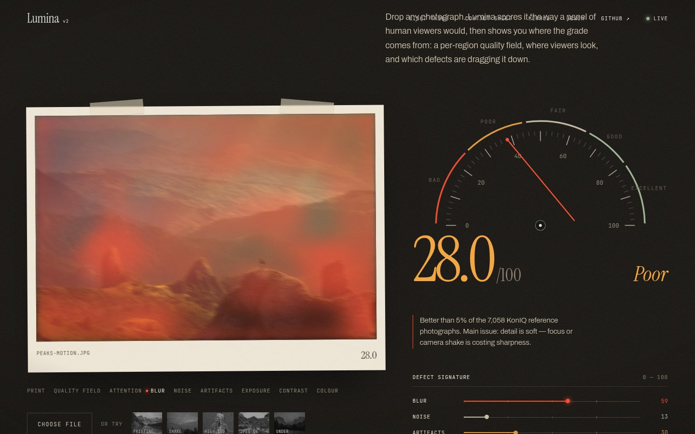
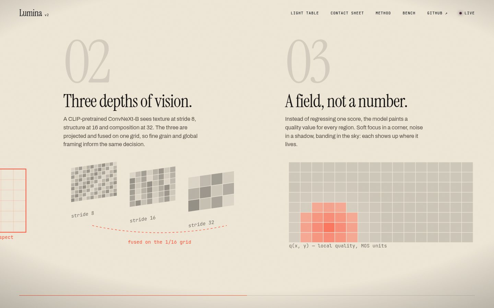

# Lumina — perceptual image quality, explained

<p align="center">
  
</p>

<p align="center">
  <a href="https://lumina-iqa.vercel.app"><b>Live app</b></a> ·
  <a href="https://huggingface.co/spaces/sawabedarain/Lumina-IQA">Inference API (HF Space)</a> ·
  <a href="https://huggingface.co/sawabedarain/lumina-iqa">Model weights &amp; card</a>
</p>

**Lumina** is a no-reference image quality assessment (NR-IQA) system. Give it a photograph and it predicts the
mean opinion score a panel of human viewers would assign (0–100), and shows *why*:

- a **quality field**: local quality for every region of the frame
- an **attention map**: where viewers look; the final score is the attention-weighted mean of the field
- **six defect maps + scores**: blur, noise, artifacts, exposure, contrast, colour
- **five perceptual attributes** calibrated on human ratings: sharpness, noise-free, contrast, colourfulness, brightness
- classical **forensics**: EXIF, JPEG quality estimate, Laplacian sharpness, noise σ, clipping, histogram, palette

The web app adds a *contact sheet* that ranks a burst of frames and circles the keeper.

## Results

| Test set | **v2 SRCC** | **v2 PLCC** | v2 RMSE | v1 SRCC | v1 PLCC |
|---|---|---|---|---|---|
| KonIQ-10k — official test split (2,015) | **0.940** | **0.950** | 5.04 | 0.894 | 0.919 |
| LIVE Challenge — zero-shot, never trained on (1,169) | **0.830** | **0.837** | 11.61 | 0.742 | 0.776 |
| SPAQ — held-out 20% (2,225) | **0.930** | **0.934** | 8.58 | 0.851 | 0.843 |
| KADID-10k — held-out reference scenes (2,000) | **0.882** | **0.887** | 11.74 | 0.521 | 0.543 |

SRCC/PLCC = Spearman/Pearson correlation with human mean opinion scores (higher is better); RMSE on the 0–100 KonIQ scale.
v2 uses horizontal-flip test-time averaging. *v1 was trained on a random 80/20 split of all of KonIQ, so most of the
official KonIQ test images were in its training set: its KonIQ row is optimistic; LIVE-C, SPAQ and KADID are the fair
comparisons.* The deployed int8 ONNX service, measured end-to-end through its own preprocessing, scores
0.940 SRCC on KonIQ test and 0.840 on LIVE-C, the same as fp32.

<p align="center"></p>
<p align="center"></p>

## What changed from v1

| | v1 | v2 |
|---|---|---|
| Backbone | EfficientNet-B0 (ImageNet) | ConvNeXt-B, CLIP LAION-2B pretrain (92M params) |
| Input | squashed to 224×224 | native aspect, long side 512 px, fully convolutional |
| Head | one linear regressor | multi-scale fusion → quality map, attention map, 6 defect maps, 5 attributes |
| Training data | KonIQ-10k (random 80/20) | KonIQ-10k (official split) + KonIQ++ defects + SPAQ + KADID-10k + synthetic degradations |
| Loss | MSE | smooth-L1 + PLCC + pairwise rank, masked BCE, attribute L1, degradation-rank constraint |
| Training | 3 epochs fp32/fp16 | 40 epochs, bf16, EMA, per-group LR, cosine, ~185 img/s on an RTX 5090 |
| Serving | PyTorch on CPU | ONNX Runtime int8, no PyTorch in the image |
| API | `/predict` → one number | `/analyze` full read-out; `/predict` kept backward-compatible |

## Architecture

```
image (native aspect, ≤512×384)
  └─ ConvNeXt-B (CLIP) ── stride 8 ─┐
                       ── stride 16 ─┼─ 1×1 proj → align on 1/16 grid → concat → 2× (3×3 conv, GN, GELU) = F
                       ── stride 32 ─┘
F ─┬─ quality head    q(x,y)          ┐
   ├─ attention head  w(x,y) > 0      ├─ score   = Σ w·q / Σ w
   ├─ defect head     d_k(x,y), k=1..6 ┘ defects = Σ w·d_k / Σ w
   └─ attribute head  (attention-pooled F) → 5 SPAQ attributes
```

Each training step draws a single-source batch:

| Source | Images (train) | Supervises |
|---|---|---|
| KonIQ-10k (official split) | 7,058 | MOS (canonical scale) |
| KonIQ++ | same images | blur / artifacts / contrast / colour defect votes |
| SPAQ | 8,900 | MOS (own affine calibration) + 5 human-rated attributes |
| KADID-10k (reference-disjoint split) | 8,190 | MOS (own calibration) + defect family & level for 25 distortion types |
| Synthetic degradations of KonIQ images | ⅓ of every KonIQ batch | defect family & severity; *degraded copy must score below its original* |

## Repository

```
lumina/            model, data pipeline, synthetic degradations, losses, training, evaluation, ONNX export, forensics
server/app.py      FastAPI + ONNX Runtime inference service (/analyze, /predict)
scripts/           dataset preparation, HF Hub publishing
frontend/          React + Vite + framer-motion + Lenis web app (deployed on Vercel)
tests/             API and forensics tests
```

## Run the API locally

```bash
pip install -r requirements.txt
uvicorn server.app:app --port 7860          # downloads weights from the HF Hub on first start
curl -F "file=@photo.jpg" localhost:7860/analyze
```

Or with Docker: `docker build -t lumina . && docker run -p 7860:7860 lumina`.

## Run the frontend

```bash
cd frontend && npm install
VITE_API_URL=http://localhost:7860 npm run dev
```

## Train from scratch

```bash
pip install torch torchvision --index-url https://download.pytorch.org/whl/cu128
pip install -r requirements-train.txt

# datasets: KonIQ-10k (512x384), KADID-10k, SPAQ, LIVE Challenge + pyiqa meta-info CSVs
# (mirrors: huggingface.co/datasets/chaofengc/IQA-PyTorch-Datasets and -metainfo)
python scripts/prepare_data.py --root /data/iqa

python -m lumina.train    --data /data/iqa --out runs/lumina_v2 --epochs 40
python -m lumina.evaluate --ckpt runs/lumina_v2/best.pt --data /data/iqa --out reports
python -m lumina.export   --ckpt runs/lumina_v2/best.pt --out export --quantize --metrics reports/metrics.json
```

## Datasets & credit

KonIQ-10k and KonIQ++ (Hosu et al., Su et al.), SPAQ (Fang et al.), KADID-10k (Lin et al.), LIVE In the Wild
Challenge (Ghadiyaram & Bovik). Datasets are used for research under their respective licenses and are not
redistributed here. Sample photographs on the site are from Unsplash.

## License

MIT, by [Darain Hyder](https://github.com/DarainHyder).
